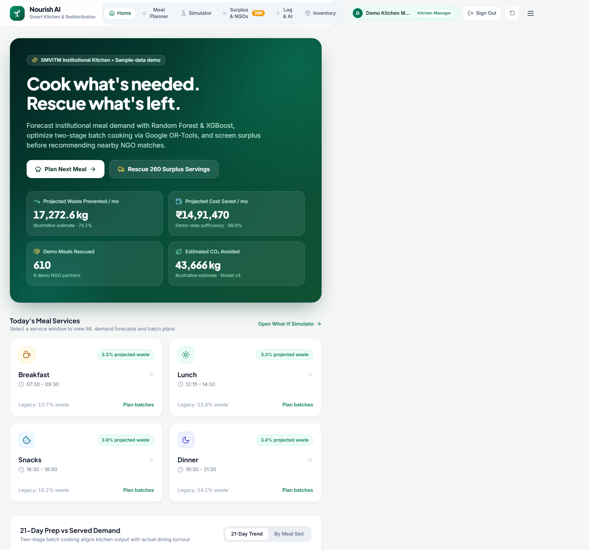
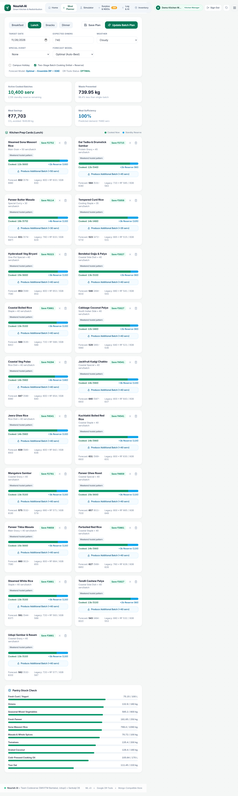
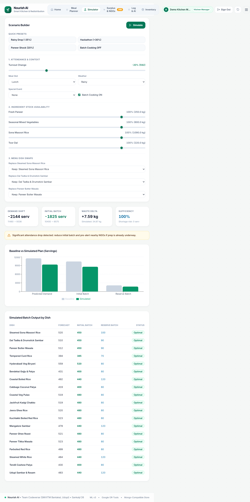
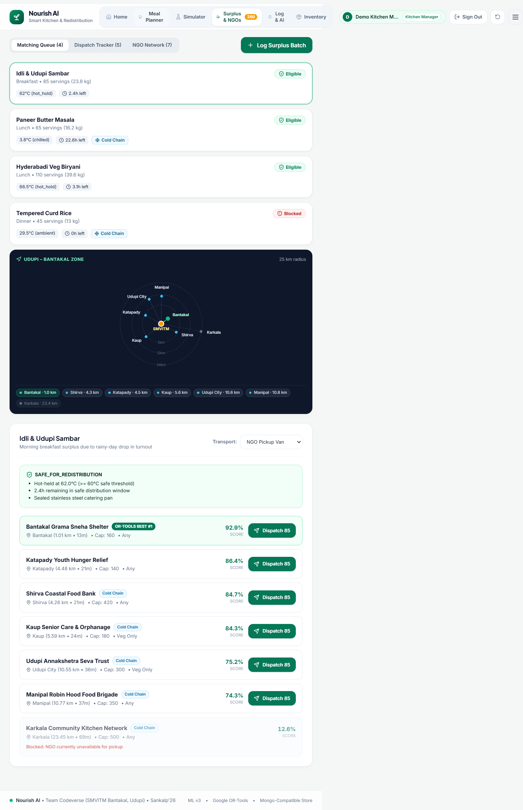
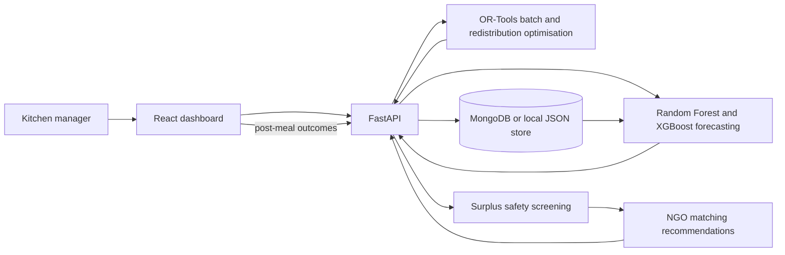

# NOURISH AI

**Smart kitchen management and food redistribution**
Team Codeverse · SMVITM, Bantakal, Udupi · SANKALP'26 Theme 02

NOURISH AI is a prototype for institutional kitchens. It forecasts meal demand, recommends initial and reserve cooking batches, lets managers explore what-if scenarios, records meal outcomes, and screens surplus for potential redistribution.

## Screenshots

| Overview | Meal planning |
| --- | --- |
|  |  |

| What-if simulation | Surplus and NGO matching |
| --- | --- |
|  |  |

## Architecture



## What is implemented

- **Demand forecasting:** Random Forest and XGBoost are evaluated using five date-based expanding-window folds against a same-dish/weekday baseline. The application uses an ML model only when it meets the baseline criteria; otherwise it falls back to the baseline.
- **Batch planning:** OR-Tools recommends initial and reserve cooking quantities subject to ingredient inventory.
- **What-if simulation:** Re-runs forecasts and planning with changed attendance, menu, weather, or ingredient availability.
- **Post-meal feedback:** Records actual meals and leftovers, supports CSV imports, and can retrain the models.
- **Surplus workflow:** Applies configured storage and holding-time checks, then recommends compatible nearby NGO partners. Recommendations are a prototype workflow, not confirmation of a real pickup.

## Data and evaluation limitations

The checked-in meal-log dataset contains **1,440 synthetic seed rows** and **3,003 CSV-imported rows**. The source provenance of the imported rows is not documented in this repository. Validation with verified real kitchen data is pending.

On the current sample dataset, **Random Forest and XGBoost each beat the same-dish/weekday baseline on MAE in all 5 of 5 date-based validation folds**. This is a sample-data comparison, not a claim of 95% accuracy or a guarantee of real-world performance. Use the dashboard metrics as evaluation results for this dataset only.

The roughly **3 MB meal-log store** and **19 MB model artifact** are checked in to support a zero-configuration local demo. The store is demo/sample data and should not be treated as operational records.

## Quick start

Requirements: Python and Node.js/npm.

1. Install backend dependencies from the repository root:

   ```powershell
   python -m pip install -r backend/requirements.txt
   ```

2. Build the frontend so FastAPI can serve it at the root URL:

   ```powershell
   cd frontend
   npm ci
   npm run build
   cd ..
   ```

3. Configure a secret before starting the backend. Generate a random value and keep it private:

   ```powershell
   python -c "import secrets; print(secrets.token_hex(32))"
   $env:NOURISH_AUTH_SECRET = "<paste the generated value here>"
   ```

   Keep the environment variable set in the same terminal used to start the backend. For persistent local setup, put `NOURISH_AUTH_SECRET=<generated value>` in `backend/.env`; `.env` files are ignored by Git. The backend refuses to start without a secret of at least 32 characters. `start_nourish_ai.ps1` generates and stores a random local secret in `backend/.env` if one is missing.

4. Start the backend from the repository root:

   ```powershell
   python -m uvicorn backend.app.main:app --host 127.0.0.1 --port 8000
   ```

5. Open `http://127.0.0.1:8000` and **register a new account**. There is no seeded demo login or demo OTP.

There is no hosted live demo at present; the application runs locally.

For frontend development with hot reload, keep the backend running and use a second terminal:

```powershell
cd frontend
npm ci
npm run dev
```

Open `http://127.0.0.1:5173`. Vite proxies `/api` requests to the local backend.

The app uses a local JSON document store by default and can use MongoDB when configured with `MONGODB_URI`. Password-reset OTP delivery requires a configured SMTP, Brevo, or Resend provider.

## Tests

From the repository root:

```powershell
python -m pytest backend/tests/test_api.py -v
```

## Main technologies

Python · FastAPI · scikit-learn · XGBoost · Google OR-Tools · React · Vite · MongoDB-compatible local JSON store
